# CAT Transaction 小时图表详解

> 适用版本：本仓库 `master`（CAT 4.x）
>
> 本文说明 Transaction 报表中某个 Type / Name 的四张小时图表：**Duration Distribution、Hits Over Time、Average Duration Over Time、Failures Over Time**。
>
> 核心结论和计算逻辑均标注 `文件:行号`，便于回到源码核对。
>
> 源码行号已于 2026-11-08 对照 GitHub `dianping/cat` master 逐条核对。

---

<a id="toc"></a>

## 目录

- [0. 结论速览](#s0)
- [1. 图表入口与生成位置](#s1)
- [2. 用一个比喻理解四张图](#s2)
- [3. Hits Over Time：每分钟有多少请求？](#s3)
- [4. Average Duration Over Time：每分钟平均处理多久？](#s4)
- [5. Duration Distribution：请求耗时怎么分布？](#s5)
- [6. Failures Over Time：每分钟失败多少次？](#s6)
- [7. 四张图如何组合分析？](#s7)
- [8. 推荐的实际看图顺序](#s8)
- [9. 最容易踩的四个坑](#s9)
- [10. 最终总结](#s10)
- [11. 源码索引](#s11)

---

<a id="s0"></a>

## 0. 结论速览

这四张图不是四张独立报表，而是 **CAT Transaction 报表中某个 Type / Name 的小时图表**。它们分别回答四个问题：

| 图表 | 中文理解 | 核心问题 | 横轴 | 纵轴 |
|---|---|---|---|---|
| Duration Distribution | 耗时分布 | 快请求、普通请求和慢请求分别有多少？ | 耗时区间（ms） | 请求次数 |
| Hits Over Time | 调用量趋势 | 每分钟来了多少请求？ | 当前小时的分钟 | 执行次数 |
| Average Duration Over Time | 平均耗时趋势 | 每分钟平均处理多久？ | 当前小时的分钟 | 平均耗时（ms） |
| Failures Over Time | 失败量趋势 | 每分钟失败多少次？ | 当前小时的分钟 | 失败次数 |

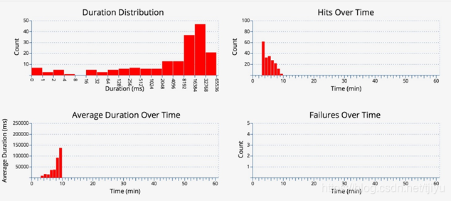

*图 1：CAT Transaction 小时图表真实界面，左上 Duration Distribution、右上 Hits Over Time、左下 Average Duration Over Time、右下 Failures Over Time。来源：社区转载的 CAT 文档截图（https://blog.csdn.net/tjiyu/article/details/90757319）。*

一句话记忆：

> **Hits 看调用量，Average Duration 看整体快慢，Duration Distribution 看耗时结构，Failures 看失败情况。**

实际分析时推荐：

> **先看量，再看错；再看快慢，最后看分布。**

---

<a id="s1"></a>

## 1. 图表入口与生成位置

在 Transaction 报表中选择应用（Domain）、Type、Name 以及 IP（或 All）后，可以进入对应的小时图表页面。

四张图在 `Handler.buildTransactionNameGraph()` 中统一创建：

- `graph1`：Duration Distribution
- `graph2`：Hits Over Time
- `graph3`：Average Duration Over Time
- `graph4`：Failures Over Time

源码：`cat-home/src/main/java/com/dianping/cat/report/page/transaction/Handler.java:115-133`

页面按 `graph1`～`graph4` 的顺序输出：

源码：`cat-home/src/main/webapp/jsp/report/transaction/transactionGraphs.jsp:23-28`

处理流程上，`GRAPHS` 动作获取小时报表，按请求条件合并 Name 和机器数据，再调用 `buildTransactionNameGraph()`：

源码：`cat-home/src/main/java/com/dianping/cat/report/page/transaction/Handler.java:267-282`

---

<a id="s2"></a>

## 2. 用一个比喻理解四张图

把 CAT 想象成一家奶茶店的经营监控大屏，把一个 Transaction 想象成“制作一杯奶茶”：从顾客下单开始，到奶茶制作完成结束。

那么：

- **Hits Over Time**：每分钟接了多少单？
- **Average Duration Over Time**：每分钟平均多久做好一杯？
- **Duration Distribution**：所有订单分别落在哪些制作时长区间？
- **Failures Over Time**：每分钟做砸或退了多少单？


*图 2：奶茶店比喻 —— 客流量、平均出餐时间、出餐时长分布、做砸订单数分别对应四张图。*

只看出餐平均时间，可能不知道客流量是否暴涨；只看失败数量，可能不知道失败率是否严重；只看平均值，也可能看不到少数顾客等得特别久。因此四张图需要组合分析。

---

<a id="s3"></a>

## 3. Hits Over Time：每分钟有多少请求？

### 3.1 含义

Hits Over Time 统计当前小时内，**每分钟执行了多少次 Transaction**。

- 横轴：分钟，0～59。
- 纵轴：执行次数。
- 成功和失败的 Transaction 都计入执行次数。
- 它反映调用量，不直接反映系统快慢。

图表读取的是每个分钟 `Range` 中的 `count`：

```java
values[value] += range.getCount();
```

源码：`cat-home/src/main/java/com/dianping/cat/report/page/transaction/GraphPayload.java:189-211`

分钟 `Range` 的 `count` 在 Transaction 处理时递增，不区分成功和失败：

源码：`cat-consumer/src/main/java/com/dianping/cat/consumer/transaction/TransactionAnalyzer.java:429-445`

### 3.2 怎么理解？

例如：

| 时间 | 执行次数 |
|---|---:|
| 10:00 | 1000 |
| 10:01 | 1200 |
| 10:02 | 9000 |

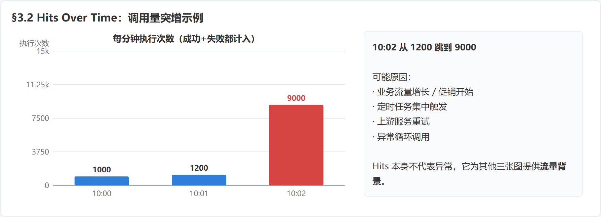

*图 3：文中示例 —— 10:02 调用量从 1200 跳到 9000。Hits 为其他三张图提供流量背景。*

10:02 的调用量突然上涨，可能对应：

- 业务流量增长或促销活动开始；
- 定时任务集中触发；
- 上游服务重试；
- 异常循环调用。

Hits 的主要价值是为其他图表提供背景：

> 系统是在高流量下变慢，还是流量不变时自身出现了性能问题？

### 3.3 注意事项

- 调用量高不等于系统异常。
- 调用量不变也不等于系统健康。
- 流量下降时，还要结合失败图判断是业务请求真的减少，还是上游已经无法正常发起请求。

---

<a id="s4"></a>

## 4. Average Duration Over Time：每分钟平均处理多久？

### 4.1 含义

Average Duration Over Time 统计当前小时内，**每分钟 Transaction 的平均执行耗时**。

- 横轴：分钟，0～59。
- 纵轴：平均耗时，单位为毫秒。
- 成功和失败的 Transaction 都参与总耗时和执行次数统计。

计算公式：

```text
某分钟平均耗时 = 该分钟所有 Transaction 的总耗时 ÷ 该分钟执行总次数
```

CAT 在统计完成后通过 `sum / count` 计算每个分钟的 `avg`：

```java
range.setAvg(range.getSum() / range.getCount());
```

源码：`cat-consumer/src/main/java/com/dianping/cat/consumer/transaction/TransactionStatisticsComputer.java:176-180`

图表读取每个分钟 `Range` 中的 `avg`：

```java
values[value] += range.getAvg();
```

源码：`cat-home/src/main/java/com/dianping/cat/report/page/transaction/GraphPayload.java:78-100`

`Range` 数据结构中同时保存 `count`、`sum`、`avg` 和 `fails`：

源码：`cat-consumer/src/main/resources/META-INF/dal/model/transaction-report-model.xml:70-87`

### 4.2 计算示例

假设一分钟内有三次请求：

- 请求 A：100ms；
- 请求 B：200ms；
- 请求 C：600ms。

则该分钟平均耗时为：

```text
(100 + 200 + 600) ÷ 3 = 300ms
```

如果趋势变成：

```text
10:00    80ms
10:01    90ms
10:02   300ms
10:03   800ms
10:04  1500ms
```

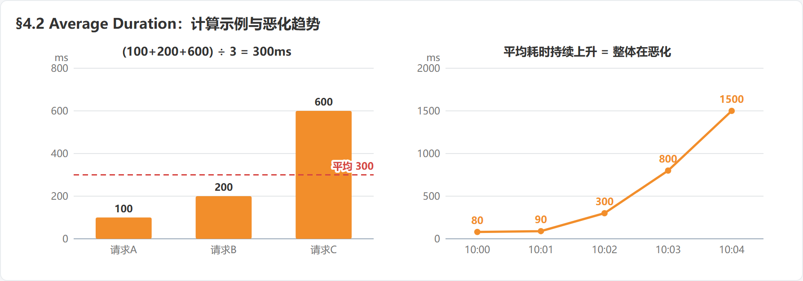

*图 4：左 —— 三次请求 100/200/600ms，平均 300ms；右 —— 平均耗时逐分钟上升，说明整体在恶化。*

说明系统整体处理速度可能正在持续恶化。常见原因包括慢 SQL、下游接口延迟、线程池或连接池耗尽、锁竞争、GC 停顿以及 CPU、内存或网络瓶颈。

### 4.3 陷阱一：平均数会掩盖个体差异

假设 10 次请求中，9 次各耗时 100ms，1 次耗时 9100ms：

```text
平均耗时 = (9 × 100 + 9100) ÷ 10 = 1000ms
```

但真实体验是：9 个请求很快，1 个请求非常慢。

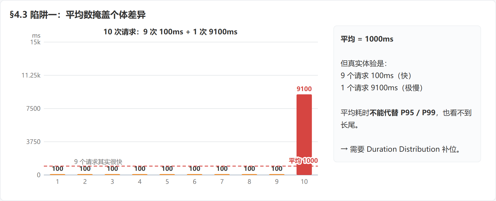

*图 5：9 次 100ms + 1 次 9100ms，平均线落在 1000ms —— 平均值既不代表快的 9 个，也掩盖了极慢的那 1 个。*

反过来，当极慢请求只占很小比例时，平均耗时也可能看起来仍然正常。因此：

> **Average Duration 不能代替 P95、P99，也不能完整反映长尾问题。**

补充一个容易忽略的事实：CAT 在分钟 `Range` 上其实存了 P95/P99（`line95Value`、`line99Value`，由 `visitRange()` 计算），但这四张小时图只读 `count`/`avg`/`fails`/`durations`，并不展示这些分位数。所以"看长尾"要么查报表里的分位数字段，要么靠 Duration Distribution 的右尾形态。

源码：`cat-consumer/src/main/java/com/dianping/cat/consumer/transaction/TransactionStatisticsComputer.java:182-195`、`cat-consumer/src/main/resources/META-INF/dal/model/transaction-report-model.xml:78-79`

### 4.4 陷阱二：平均耗时下降不一定是好事

成功和失败的 Transaction 都参与耗时统计。如果大量请求被快速拒绝，平均耗时可能反而下降：

```text
原来：正常处理，平均耗时 500ms，失败很少
现在：直接报错，平均耗时 20ms，失败很多
```

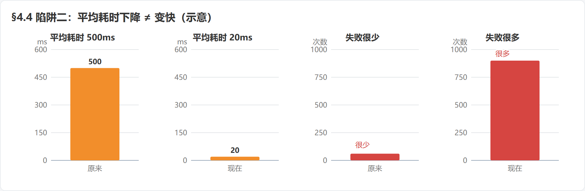

*图 6（示意，共用坐标）：平均耗时从 500ms 降到 20ms 的同时失败数大幅上升 —— 不是变快，而是失败得更快。*

这不是系统变快了，而是**失败得更快了**。因此 Average Duration 必须与 Failures Over Time 一起分析。

---

<a id="s5"></a>

## 5. Duration Distribution：请求耗时怎么分布？

### 5.1 含义

Duration Distribution 将选定小时内的 Transaction 按 CAT 预定义的耗时档位聚合，统计每个耗时区间有多少次请求。

- 横轴：耗时区间，单位为毫秒。
- 纵轴：请求次数。
- 它展示一段时间内的整体耗时结构，不是每分钟的变化趋势。

图表遍历 `TransactionName` 的 `durations`，将每个耗时档位的 `count` 放入对应区间：

源码：`cat-home/src/main/java/com/dianping/cat/report/page/transaction/GraphPayload.java:102-158`

档位共 17 个：0 以及 1、2、4、…、65536 ms。归档规则是"不小于耗时的最小 2 的幂"，超过 65536ms 一律计入最后一档；因此档位 k（k≥2）实际代表耗时落在 (k/2, k] 区间的请求，看横轴时要把标签理解为区间上界。

源码：`cat-consumer/src/main/java/com/dianping/cat/consumer/transaction/TransactionAnalyzer.java:279-290`

### 5.2 怎么看？

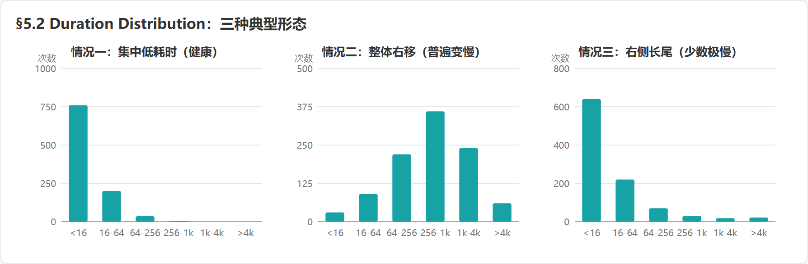

*图 7：三种典型耗时分布形态（横轴为耗时区间 ms）—— 集中低耗时、整体右移、右侧长尾。*

#### 情况一：请求主要集中在低耗时区间

说明大多数请求处理较快，系统整体状态较好。

#### 情况二：请求整体向高耗时区间移动

说明不是只有个别请求变慢，而是大量请求都在变慢。如果 Average Duration 同时上升，通常意味着比较普遍的性能问题。

#### 情况三：大多数请求很快，但右侧存在长尾

说明大多数用户体验正常，但少数请求特别慢。此时平均耗时可能并不夸张，仍需要继续检查：

- P95、P99 等分位耗时；
- 慢请求对应的日志和调用链；
- 慢请求是否集中在某台机器；
- 是否集中在某个接口、参数或下游服务。

### 5.3 与 Average Duration 的区别

| 图表 | 关注点 | 回答的问题 |
|---|---|---|
| Average Duration Over Time | 时间趋势 | 每分钟整体平均有多慢？ |
| Duration Distribution | 耗时结构 | 快请求、普通请求和慢请求分别有多少？ |

Average 是趋势曲线，Distribution 是聚合分布图。两者结合，才能区分“普遍变慢”和“少数请求拖尾”。

---

<a id="s6"></a>

## 6. Failures Over Time：每分钟失败多少次？

### 6.1 含义

Failures Over Time 统计当前小时内，**每分钟有多少次 Transaction 执行失败**。

- 横轴：分钟，0～59。
- 纵轴：失败次数。
- 它展示失败数量，不是失败率。

图表读取每个分钟 `Range` 中的 `fails`：

```java
values[value] += range.getFails();
```

源码：`cat-home/src/main/java/com/dianping/cat/report/page/transaction/GraphPayload.java:160-187`

Transaction 失败时，当前分钟的失败数递增：

源码：`cat-consumer/src/main/java/com/dianping/cat/consumer/transaction/TransactionAnalyzer.java:429-445`

### 6.2 失败次数不等于失败率

例如：

| 调用量 | 失败数 | 失败率 |
|---:|---:|---:|
| 100 | 10 | 10% |
| 10000 | 10 | 0.1% |

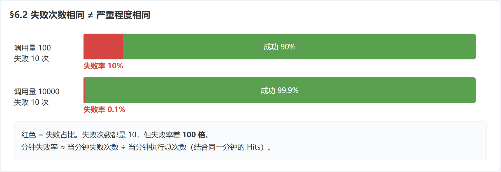

*图 8：红色为失败占比。失败次数都是 10，但失败率 10% 与 0.1% 相差 100 倍。*

两种情况的失败次数相同，但严重程度完全不同。因此需要结合同一分钟的 Hits 估算：

```text
分钟失败率 ≈ 当分钟失败次数 ÷ 当分钟执行总次数
```

Failures Over Time 适合发现：

- 故障从哪一分钟开始；
- 错误是突然爆发还是持续发生；
- 发布、重启或流量上涨之后是否出现异常；
- 故障是否只持续了几个分钟。

---

<a id="s7"></a>

## 7. 四张图如何组合分析？

| 图表组合 | 主要用途 |
|---|---|
| Hits + Failures | 判断流量规模、失败规模和近似失败率 |
| Hits + Average Duration | 判断性能下降是否与流量增长同步 |
| Average Duration + Failures | 避免把“快速失败”误判为“性能提升” |
| Average Duration + Duration Distribution | 区分普遍变慢与少数请求拖尾 |

### 7.1 场景一：流量暴涨，系统逐渐扛不住

典型表现：

- **Hits**：调用量突然上升；
- **Average Duration**：平均耗时持续上升；
- **Duration Distribution**：请求整体向高耗时区间移动；
- **Failures**：随后失败次数明显增加。

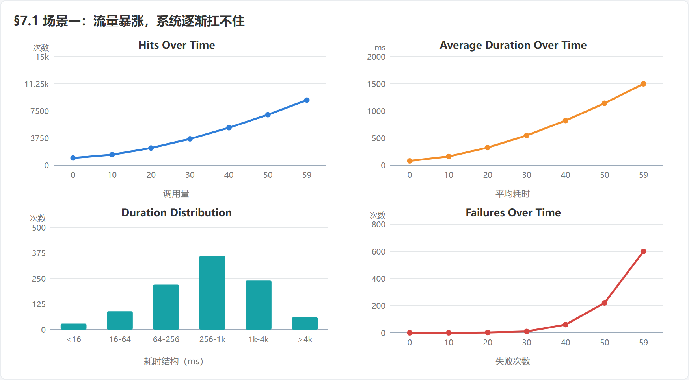

*图 9：场景一示意 —— 流量先涨，平均耗时跟涨，分布右移，失败最后爆发。*

就像奶茶店突然涌进大量顾客：先排队变慢，随后制作普遍变慢，最后开始大量退单。

优先排查：系统容量、线程池、数据库连接池、CPU/内存、下游服务过载、限流和重试风暴。

### 7.2 场景二：流量没变，但系统变慢

典型表现：

- **Hits**：基本不变；
- **Average Duration**：明显上升；
- **Duration Distribution**：慢请求增多；
- **Failures**：暂时不明显。

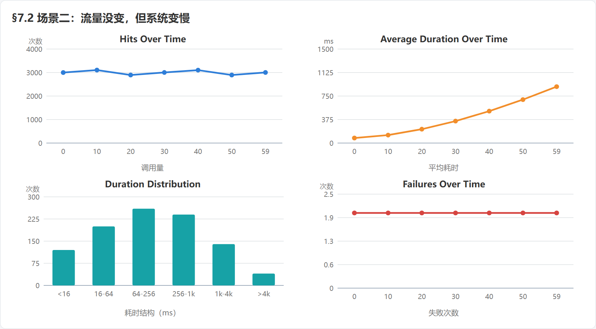

*图 10：场景二示意 —— 流量平稳但平均耗时上升、慢请求增多，失败暂不明显。*

说明请求仍然能够完成，只是处理时间变长。

优先排查：慢 SQL、下游接口延迟、锁竞争、GC 停顿、网络问题或个别机器异常。

### 7.3 场景三：平均耗时下降，但系统发生故障

典型表现：

- **Hits**：可能基本不变；
- **Average Duration**：明显下降；
- **Failures**：大幅上升；
- **Duration Distribution**：大量请求集中在低耗时区间。

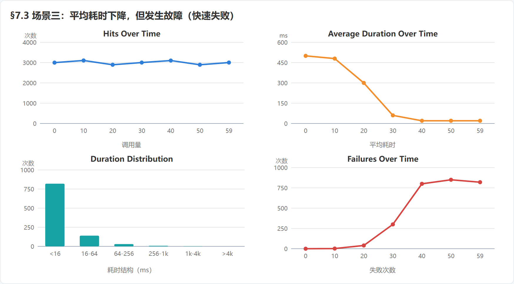

*图 11：场景三示意 —— 平均耗时骤降、分布挤向低耗时、失败大幅上升，是快速失败而非性能改善。*

这通常不是性能改善，而是大量请求被参数校验、权限、限流或异常逻辑快速拒绝。

> **低耗时不等于健康，必须同时检查失败次数。**

### 7.4 场景四：平均耗时正常，但少数用户非常慢

典型表现：

- **Hits**：正常；
- **Average Duration**：变化不大；
- **Duration Distribution**：右侧出现长尾；
- **Failures**：可能没有明显增加。

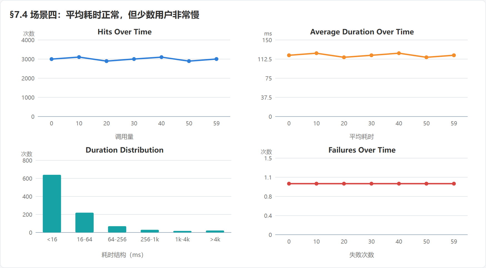

*图 12：场景四示意 —— 量、平均耗时、失败都正常，只有分布图右侧露出长尾。*

说明整体指标看似正常，但少数请求非常慢。

优先排查：特定机器、特定用户或参数、慢 SQL、大对象处理、个别下游节点异常以及 P99 变化。

---

<a id="s8"></a>

## 8. 推荐的实际看图顺序

### 第一步：看 Hits，确认流量背景

- 调用量是否突然上涨或下降？
- 是否存在规律性峰值？
- 故障是否正好伴随流量变化？

### 第二步：看 Failures，确认是否已经出错

- 错误从哪一分钟开始？
- 是持续失败还是瞬时抖动？
- 结合 Hits 判断失败规模是否严重？

### 第三步：看 Average Duration，确认性能趋势

- 是逐渐变慢还是突然变慢？
- 变慢是否与流量上涨同步？
- 耗时下降是否伴随失败增加？

### 第四步：看 Duration Distribution，确认慢请求结构

- 是所有请求普遍变慢？
- 还是只有少数请求特别慢？
- 是否存在明显长尾？

---

<a id="s9"></a>

## 9. 最容易踩的四个坑

1. **只看平均耗时**：平均数会掩盖个体差异和长尾慢请求。
2. **只看失败次数**：必须结合调用量判断失败率和影响范围。
3. **把耗时下降当成性能改善**：如果失败同时增加，可能只是快速失败。
4. **把四张图割裂分析**：流量、平均耗时、耗时分布和失败情况必须放在同一时间背景下判断。

---

<a id="s10"></a>

## 10. 最终总结

用奶茶店来概括：

- **Hits** 是“客流量”；
- **Average Duration** 是“平均出餐时间”；
- **Duration Distribution** 是“不同出餐时间的订单分布”；
- **Failures** 是“做砸的订单数”。

最重要的三个原则：

1. 平均耗时不能代表所有用户的真实体验；
2. 失败次数必须结合调用量分析；
3. 耗时降低不一定是好事，还要确认失败是否增加。

最终记忆法：

> **Hits 看量，Failures 看错，Average 看快慢，Distribution 看分布。**
>
> **先看量，再看错；再看快慢，最后看分布。**

---

<a id="s11"></a>

## 11. 源码索引

| 内容 | 文件与行号 |
|---|---|
| 创建四张图 | `cat-home/src/main/java/com/dianping/cat/report/page/transaction/Handler.java:115-133` |
| GRAPHS 动作处理与数据合并 | `cat-home/src/main/java/com/dianping/cat/report/page/transaction/Handler.java:267-282` |
| JSP 输出四张图 | `cat-home/src/main/webapp/jsp/report/transaction/transactionGraphs.jsp:23-28` |
| Average Duration 图表数据 | `cat-home/src/main/java/com/dianping/cat/report/page/transaction/GraphPayload.java:78-100` |
| Duration Distribution 图表数据 | `cat-home/src/main/java/com/dianping/cat/report/page/transaction/GraphPayload.java:102-158` |
| Failures 图表数据 | `cat-home/src/main/java/com/dianping/cat/report/page/transaction/GraphPayload.java:160-187` |
| Hits 图表数据 | `cat-home/src/main/java/com/dianping/cat/report/page/transaction/GraphPayload.java:189-211` |
| 分钟调用量、总耗时与失败数采集 | `cat-consumer/src/main/java/com/dianping/cat/consumer/transaction/TransactionAnalyzer.java:429-445` |
| 分钟平均值 `sum / count` | `cat-consumer/src/main/java/com/dianping/cat/consumer/transaction/TransactionStatisticsComputer.java:176-180` |
| 分钟 Range 数据结构 | `cat-consumer/src/main/resources/META-INF/dal/model/transaction-report-model.xml:70-87` |
| 耗时档位归档规则（2 的幂、封顶 65536） | `cat-consumer/src/main/java/com/dianping/cat/consumer/transaction/TransactionAnalyzer.java:279-290` |
| 分钟级 P95/P99 计算（四图不展示） | `cat-consumer/src/main/java/com/dianping/cat/consumer/transaction/TransactionStatisticsComputer.java:182-195` |
| Range 上的分位数字段 | `cat-consumer/src/main/resources/META-INF/dal/model/transaction-report-model.xml:78-79` |
